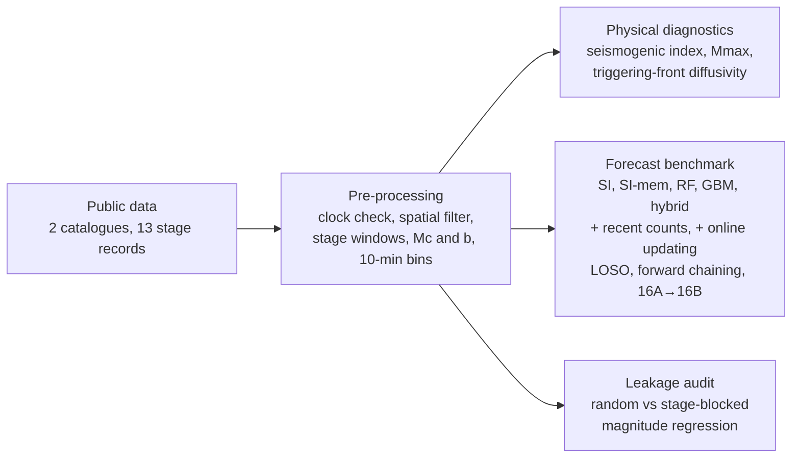

# Stage-blocked benchmark of induced-seismicity forecasts — Utah FORGE 2024


Code accompanying the manuscript

> **Physics-based versus machine-learning forecasts of induced microseismicity: a stage-blocked benchmark on the 2024 Utah FORGE stimulation** (under review)

The code reproduces every number, table and data figure in the paper from public data: two independently processed microseismic catalogues and the 1-s pumping records of the April 2024 stimulation of wells 16A(78)-32 and 16B(78)-32 at the Utah FORGE enhanced geothermal system. No data or results are stored in the repository; `run_all.sh` creates them.

## What the code does



* **Forecast target:** number of events above completeness in 10-min bins; every forecast uses only information available at the start of the bin.
* **Models:** seismogenic-index rate law (SI), SI with a causal exponential memory kernel (SI-mem), random forest, histogram gradient boosting and a physics–ML hybrid; variants with recent counts and with Gamma–Poisson online rescaling.
* **Validation:** leave-one-stage-out, forward chaining and transfer from well 16A to well 16B; Poisson log-likelihood, information gain and N-test; paired Wilcoxon tests.
* **Leakage audit:** per-event magnitude regression scored with random 80/20 splits and with stage-blocked splits.

## Quick start

```bash
git clone https://github.com/minhaz-engg/forge2024-stage-blocked-benchmark.git
cd forge2024-stage-blocked-benchmark
python -m venv .venv && source .venv/bin/activate
pip install -r requirements.txt
# download the public files into data/raw/ as described in data/README.md
bash run_all.sh            # about 1 h on a laptop; writes data/*.csv, results/ and figs/
```

## Repository layout

```
.
├── code/
│   ├── zp.py                       shared functions (stage windows, Mc, b, binning, features, SI models, scores)
│   ├── s00_prepare_catalogues.py   raw catalogues  -> compact tables
│   ├── s01_injection.py            Calfrac stage files -> 1-s injection table (UTC)
│   ├── s02_timecheck.py, s02b_epoch.py   clock-offset test
│   ├── s03_qc.py                   catalogue checks
│   ├── s04_catalog.py              spatial filter, stage assignment, Mc and b
│   ├── s05_si_rt.py                seismogenic index, maximum magnitude, diffusivity
│   ├── s06_forecast.py             forecast benchmark (LOSO, forward chaining, 16A -> 16B)
│   ├── s07_adaptive.py             online-updated SI-mem
│   ├── s08_gbm_adaptive.py         online-updated GBM and RF
│   ├── s09_leakage.py              leakage audit of magnitude regression
│   ├── s10_summary.py              summary tables and paired tests
│   ├── s11_facts.py                numbers quoted in the text
│   └── make_figures.py             data figures
├── data/README.md                  where to download the inputs
├── requirements.txt
└── run_all.sh
```

## Steps and outputs

| Script | Paper | Output in `results/` |
|---|---|---|
| `s00_prepare_catalogues.py` | Sect. 2.3 | compact catalogues in `data/` |
| `s01_injection.py` | Sect. 2.2 | `data/injection_2024_stages.csv` |
| `s02_timecheck.py`, `s02b_epoch.py` | Sect. 2.2, App. A | clock-offset test (printed) |
| `s03_qc.py` | Sect. 2.3 | catalogue checks (printed) |
| `s04_catalog.py` | Sect. 2.3–2.4, 4.1; Fig. S2 | `stage_table.csv`, filtered catalogues, `catalog_summary.csv` |
| `s05_si_rt.py` | Sect. 3.1–3.2, 4.2–4.3; Table S1 | `seismogenic_index.csv`, `diffusivity_rt.csv` |
| `s06_forecast.py` | Sect. 3.3, 3.5, 4.4–4.5 | binned series, `forecast_scores_seed0.csv`, `forecast_series_seed0.csv` |
| `s07_adaptive.py`, `s08_gbm_adaptive.py` | Sect. 3.4, 4.4 | `forecast_scores_adaptive.csv`, `forecast_scores_all.csv`, `forecast_scores_ml_adaptive.csv` |
| `s09_leakage.py` | Sect. 3.6, 4.6; Table S6 | `leakage_magnitude_regression.csv` |
| `s10_summary.py` | Tables S3–S5 | `table_LOSO.csv`, `table_FC.csv`, `table_transfer.csv`, `paired_tests.csv` |
| `s11_facts.py` | numbers in the text | `facts.json` |
| `make_figures.py` | Figs. 2, 5–10, S1, S2 | `figs/` |

Figures 1, 3 and 4 of the paper are schematics and are not generated by code.

## Reproducibility

* Models, hyper-parameters (inner leave-one-stage-out) and online-update prior weights are fitted on training stages only.
* The random forest uses a fixed seed (0).
* `requirements.txt` pins the versions used for the paper (Python 3.10). With other scikit-learn versions the gradient-boosting scores can differ in the third decimal; all other results are identical.
* The analysis was run independently on two machines; physics-model, random-forest, seismogenic-index, diffusivity and Mmax results agree to about 1e-12.

## Data

All inputs are public (see [`data/README.md`](data/README.md)):

* Niemz, P., et al. (2024). *Utah FORGE 2024 stimulations: microseismic event catalog from seismic surface network* [Data set]. Zenodo. https://doi.org/10.5281/zenodo.12817881
* Zhu, W., et al. (2026). *Utah FORGE: Phase-Picking Based Microseismic Event Catalog – April 2024 Stimulation* [Data set]. Geothermal Data Repository. https://gdr.openei.org/submissions/1817
* England, K. (2024). *Utah FORGE: Wells 16A(78)-32 and 16B(78)-32 Stimulation Pressure and Circulation Data April, 2024* [Data set]. Geothermal Data Repository. https://doi.org/10.15121/2371032

## Licence

Provided for peer review only; see [`LICENSE`](LICENSE). An open-source licence will be added when the paper is published.
